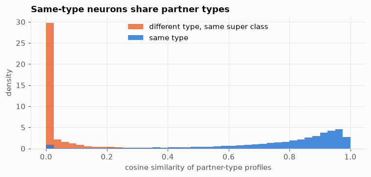

# FlyWire cell-type prediction

Semi-supervised node classification on the FlyWire whole-brain connectome of the fruit fly:
139,255 neurons, about 2.7 million weighted, directed connections, and thousands of cell types.
Given a fraction of labelled neurons, predict the type of every other neuron from its wiring.
Compare feature models, a graph neural network and the published NTAC method, and ask whether
non-connectivity features (where synapses sit, predicted neurotransmitters) help where accuracy is lowest.

> **Status: Week 2 done (splits, baselines, NTAC reproduction). Next: cell-type runs on Kaggle, then a
> graph neural network (Week 3).**

## Results so far

Test accuracy (%), mean ± sd over 5 random splits. Full tables, macro F1 and top-5: [results/results.md](results/results.md).
Split design and leakage rules: [ADR-001](docs/adr/001-splits-and-leakage.md).

**Cell type (8,840 types), seeded NTAC on the whole-brain graph**

| Seeds | 1% | 5% | 20% | 80% | Left → right | Right → left |
| --- | --- | --- | --- | --- | --- | --- |
| Accuracy | 58.9 ± 4.7 | 61.1 ± 6.3 | 92.1 ± 0.1 | 94.2 ± 0.1 | 76.3 | 86.3 |
| Top-5 accuracy | 75.0 ± 3.4 | 76.9 ± 5.1 | 97.2 ± 0.0 | 98.1 ± 0.1 | 89.8 | 93.3 |

At 20% seeds: optic lobe 96.3%, central brain 84.7%. At 1% and 5% every type gets exactly one seed
(8,840 seeds, 6.4% of neurons), so a type of 8,452 photoreceptors is matched against a single example.

**Super class (10) and class (49), LightGBM on per-neuron features**

| Task | 1% | 5% | 20% | 80% | Left → right | Right → left |
| --- | --- | --- | --- | --- | --- | --- |
| Super class | 95.6 ± 0.1 | 96.3 ± 0.8 | 97.1 ± 0.3 | 97.5 ± 0.1 | 96.8 | 96.9 |
| Class | 86.0 ± 6.8 | 87.0 ± 0.4 | 90.7 ± 0.6 | 92.6 ± 0.2 | 91.4 | 86.4 |

Majority-class floors: 55.7% (super class), 20.8% (class), 6.5% (cell type at 20% seeds).

### NTAC reproduction

`src/flyct/ntac.py` is our own implementation. On NTAC's published FlyWire subsets it makes the
**same prediction as the reference package for 100% of test neurons** (reference run single-threaded),
and matches the paper's stated numbers within about a point ([script](scripts/ntac_reproduction.py),
[results](results/ntac_reproduction.json)):

| Subset (NTAC's data) | Seeds | Ours, 5 runs | Paper |
| --- | --- | --- | --- |
| Optic lobe, intrinsic neurons | 2% | 96.0 ± 0.4 | over 95% |
| Whole visual system | 5% | 96.5 ± 0.1 | |
| Central brain | 80% | 88.2 ± 0.2 | 87% |

Two things came out of the comparison:

- **The reference kernel has a race condition.** It adds into a shared similarity matrix inside a parallel
  loop over dimensions, so multi-threaded runs lose updates and change about 10% of predictions from run
  to run (accuracy moves by about 0.3 points). Single-threaded, our results match it exactly.
- **Memory.** The reference builds a dense neurons × seeds similarity matrix: about 15 GB for the whole
  brain at 20% seeds. Ours walks only the seeds sharing a nonzero dimension with each neuron and keeps
  the best per class, so a whole-brain cell-type run takes 30 s to 3 min on a 5.9 GB laptop, and is
  about 7× faster than the reference on its own data.

### Week 2 findings

- **Coarse labels are about *where*, fine labels about *whom*.** Per-neuron features (synapses per
  neuropil, neurotransmitter mix) give 95.6% on super class with 1% seeds; partner-type profiles alone
  give far less there. For cell type, partner types are what work (see Week 1: same-type neurons share
  partner types).
- **A trained classifier on partner profiles breaks under hemisphere transfer.** Partner-profile LR gets
  91.4% on super class with 80% random seeds but 49.8% left → right, below the 55.7% majority floor.
  Seeds have full profiles (their same-side partners are labelled); the other side sees only its few
  cross-midline partners, so its profiles are nearly empty. Refilling partners with predictions (3
  rounds) recovers 81%; NTAC, which iterates from the start, does not have this problem.
- **Hemisphere transfer is asymmetric in the optic lobe.** NTAC types the right optic lobe from left
  seeds at 69.6%, the left from right seeds at 89.5%; the central brain is symmetric (about 89% both
  ways). Open question for the error analysis.

## Quickstart

```bash
py -3.12 -m venv .venv          # Linux/Kaggle: python3 -m venv .venv
gmake setup                     # Windows: gmake from Strawberry Perl, in Git Bash. Linux: make
gmake data                      # download + verify -> Parquet -> clean graph -> sanity checks
gmake explore                   # execute notebooks/01_exploration.ipynb
gmake splits                    # saved seed/val/test splits, checked against data/splits_report.json
gmake baselines                 # majority + LightGBM, super class and class
gmake graph-models              # NTAC (cell type) + partner-profile LR (super class, class)
gmake report                    # results/runs.jsonl -> results/results.md
gmake test
```

`make data` is idempotent. Verified downloads are skipped, and an interrupted download resumes.
Zenodo throttles single connections heavily on some networks, so files are fetched as 16 parallel byte ranges.
Peak memory stays under about 3 GB: Feather is streamed to Parquet one record batch at a time,
and DuckDB (capped at 2 GB, spilling to disk) does all the aggregation.

## Data card

### Sources

| File | Source | Version | md5 |
| --- | --- | --- | --- |
| `proofread_connections_783.feather` | [Zenodo 10676866](https://zenodo.org/records/10676866) | release 783 | `f48f972d262323a102aed49af1396b8a` |
| `per_neuron_neuropil_count_pre_783.feather` | Zenodo 10676866 | release 783 | `90fcdb42c1ba05ed92820840fa1e6ba0` |
| `per_neuron_neuropil_count_post_783.feather` | Zenodo 10676866 | release 783 | `bb5999f10920ade803d9f37097a43a56` |
| `proofread_root_ids_783.npy` | Zenodo 10676866 | release 783 | `e0e6c19732fd8c7a4e39a2d170105421` |
| `Supplemental_file1_neuron_annotations.tsv` | [flywire_annotations](https://github.com/flyconnectome/flywire_annotations) | tag `v3.1.0` (commit `8587524`) | see `data/checksums.md5` |

All pins live in [`src/flyct/config.py`](src/flyct/config.py). The individual-synapse table
(`flywire_synapses_783.feather`, 9.5 GB) is deliberately not used.

**Licence:** connectivity data CC-BY 4.0. Annotations: see the flywire_annotations repository.

### Processing (`src/flyct/build.py`)

1. Keep only the 139,255 proofread neurons.
2. **Sum synapses across neuropils first, then threshold** at ≥ 5 synapses per directed pair (the Codex default).
   The raw file has one row per pair *per neuropil*, so thresholding first would wrongly drop pairs whose synapses are spread out.
3. Edge neurotransmitter probabilities are the synapse-weighted mean over that pair's neuropil rows.

### Outputs (`data/processed/`)

| File | Rows | Contents |
| --- | --- | --- |
| `edges.parquet` | one per directed pair | `pre_root_id`, `post_root_id`, `syn_count`, six NT probabilities |
| `features.parquet` | one per neuron | degree and synapse totals (thresholded graph); synapse-weighted NT mix of outgoing and incoming synapses; synapses per neuropil for outputs (`pre_*`) and inputs (`post_*`), counting all synapses |
| `labels.parquet` | one per neuron | `super_class`, `cell_class`, `cell_type` (targets) and `side` (for the hemisphere split only) |

**Features and labels are separate files by design.** Nothing that builds a feature matrix needs
to open `labels.parquet`, and `make check` fails if any annotation column appears in `features.parquet`.
Columns never used as features: `hemibrain_type`, `fbbt_id` / `vfb_id` (these map to type),
lineages, `top_nt`/`known_nt`, synonyms, soma/position coordinates, and everything else in the annotation file.

### Counts (checked by `make check` against [`data/build_report.json`](data/build_report.json))

| | Count | Published reference |
| --- | --- | --- |
| Proofread neurons | 139,255 | 139,255 (Dorkenwald et al. 2024) |
| Directed edges, ≥ 5 synapses | 2,700,513 | ~2.7 million |
| Synapses in kept edges | 34,153,566 | |
| Neurons with a super class / class / cell type | 139,241 / 107,511 / 137,714 | |
| Distinct cell types (annotations v3.1.0) | 8,840 | 8,453 in Schlegel et al. 2024; later releases added types |
| Feature columns | 176 (+ `root_id`) | |

Peak memory on a 5.9 GB laptop: 0.87 GB (convert), 2.05 GB (build).

### Week 1 findings ([notebook](notebooks/01_exploration.ipynb))



- **Same-type neurons share partner types but rarely connect to each other.** 1.1% of edges join same-type
  neurons, yet same-type pairs have a median partner-type-profile cosine of 0.86 (0.00 for different types).
  This favours NTAC-style features, and means a GNN needs seed labels as input to compete.
- **Extreme label tail.** 51% of types have exactly 2 neurons; the 150 types with more than 100 neurons hold 69% of all neurons.
- **Class labels are missing for 68% of central-brain neurons**, so class-level results mainly reflect optic and sensory neurons.
- **5,074 neurons have no partner at ≥ 5 synapses** (mostly sensory). Connectivity alone can't type them.

### Known caveats

- **Left/right was flipped in the original imaging.** Annotations were corrected; coordinates were not.
  Hemisphere logic uses the `side` column only. Neuropil names carry `_L`/`_R` suffixes, so hemisphere-transfer
  models need features mirrored to "same side / other side" (Week 2).
- **Some labels were defined from connectivity.** Optic-lobe types were largely typed by their wiring, so high
  accuracy there partly recovers the labelling procedure. All results are reported by region.
- **Annotations are pinned.** v3.0.0 → v3.1.0 → v3.2.0 each retyped neurons. v3.2.0 (Sept 2026) only retypes
  gustatory sensory neurons. We stay on v3.1.0 so numbers are stable; Codex mixes sources and is not used for labels.

## Repository layout

```
src/flyct/config.py       pinned versions, checksums, paths
src/flyct/download.py     parallel, resumable, checksum-verified download
src/flyct/convert.py      Feather -> Parquet, one record batch at a time
src/flyct/build.py        DuckDB: edges, features, labels
src/flyct/checks.py       sanity checks + reproducibility check
src/flyct/splits.py       seed-fraction sweep and hemisphere-transfer splits, saved once
src/flyct/features.py     feature matrix, neuropils mirrored to ipsi/contra
src/flyct/graph.py        thresholded adjacency as a sparse matrix
src/flyct/ntac.py         seeded NTAC, numba, memory-light
src/flyct/models.py       majority, LightGBM, NTAC, partner-profile logistic regression
src/flyct/torch_models.py partner-profile LR for 8,840 classes (sparse gradients)
src/flyct/metrics.py      accuracy, top-5, weighted/macro F1, ECE, by region and type size
src/flyct/run.py          run models on splits; log to MLflow and results/runs.jsonl
src/flyct/report.py       results tables
scripts/                  NTAC reproduction against the reference package and paper
kaggle/                   notebook for cell-type runs that need more than a laptop
tests/                    NTAC against a brute-force implementation
notebooks/                exploration (01_exploration.ipynb is generated by make_01_exploration.py)
docs/                     project plan, ADRs, figures
```

## Citations

Connectivity and annotations come from the FlyWire Consortium. As the annotation repository asks, please cite:

- Dorkenwald, S. et al. *Neuronal wiring diagram of an adult brain.* Nature (2024). [doi:10.1038/s41586-024-07558-y](https://doi.org/10.1038/s41586-024-07558-y)
- Schlegel, P. et al. *Whole-brain annotation and multi-connectome cell typing of Drosophila.* Nature (2024). [doi:10.1038/s41586-024-07686-5](https://doi.org/10.1038/s41586-024-07686-5)
- Matsliah, A. et al. *Neuronal parts list and wiring diagram for a visual system.* Nature (2024). [doi:10.1038/s41586-024-07981-1](https://doi.org/10.1038/s41586-024-07981-1)
- Berg, S. et al. *Sexual dimorphism in the complete connectome of the Drosophila male central nervous system.* bioRxiv (2025). [doi:10.1101/2025.10.09.680999](https://doi.org/10.1101/2025.10.09.680999)

Baseline method: *Connectivity is all you need: inferring neuronal types with NTAC* ([code](https://github.com/BenJourdan/ntac)).
